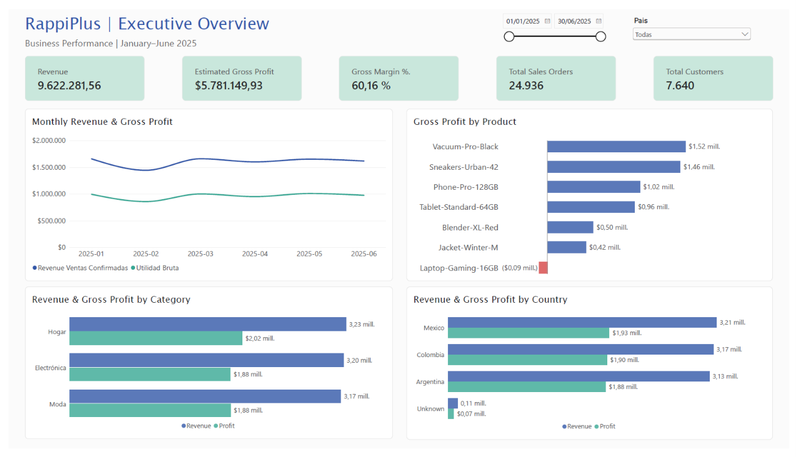
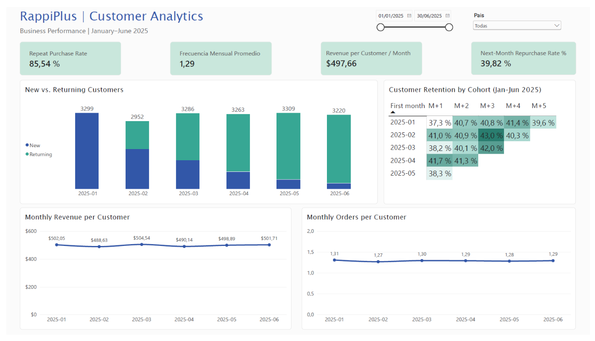

# RappiPlus | End-to-End Business Analytics

### Business Performance, Customer Retention & A/B Testing

**Python | SQL | Power BI | Statistical Analysis | Data Visualization**

## Project Overview

RappiPlus is an end-to-end business analytics project focused on evaluating the performance of an e-commerce platform operating across Latin American markets.

The analysis combines transactional, product, marketing, and experimental data to identify business opportunities, evaluate customer behavior, and support data-driven decisions.

The project covers the complete analytical workflow, from data quality assessment and preprocessing to exploratory analysis, SQL-based behavioral analysis, statistical testing, and interactive business intelligence dashboards.

**Analysis period:** January–June 2025.

## Business Objectives

The project addresses five key business questions:

1. How is the business performing in terms of revenue, profitability, and sales?
2. Which products, categories, and countries contribute most to financial performance?
3. How frequently do customers purchase, and how effectively does the business retain them?
4. What behavioral patterns can be identified through funnel and cohort analysis?
5. Does a checkout interface experiment provide evidence of improved conversion?

## Tools & Technologies

| Technology       | Application                                               |
| ---------------- | --------------------------------------------------------- |
| Python           | Data cleaning, exploratory analysis, and business metrics |
| Pandas & NumPy   | Data manipulation and quantitative analysis               |
| SQL / PostgreSQL | Behavioral, funnel, and cohort analysis                   |
| SciPy            | Statistical hypothesis testing                            |
| Matplotlib       | Analytical visualizations                                 |
| Power BI         | Interactive dashboards and DAX measures                   |
| Jupyter Notebook | Reproducible analytical workflows                         |

## Key Business Results

The analysis identified the following results:

| Business Metric                      |        Result |
| ------------------------------------ | ------------: |
| Confirmed Sales Revenue              | $9,622,281.56 |
| Estimated Gross Profit               | $5,781,149.93 |
| Estimated Gross Margin               |        60.16% |
| Sales Orders                         |        24,936 |
| Unique Purchasing Customers          |         7,640 |
| Repeat Purchase Rate                 |        85.54% |
| Monthly Purchase Frequency           |          1.29 |
| Average Monthly Revenue per Customer |       $497.66 |
| Next-Month Repurchase Rate           |        39.82% |

*Revenue and profit are reported in the monetary units of the source dataset. Gross profit and margin are estimates based on the available cost information and applicable transaction filters.*

### Key Findings

**1. Business profitability**

The business generated positive estimated gross profit during the analysis period. However, profitability varied across products, indicating opportunities to improve product-level financial performance.

**2. Customer retention**

A high proportion of purchasing customers completed multiple purchases during the analysis period.

Nevertheless, the next-month repurchase rate was considerably lower, highlighting an opportunity to strengthen consecutive-month retention.

**3. Customer purchasing behavior**

Purchasing customers placed approximately 1.29 orders per active month, providing a basis for evaluating customer engagement and purchase frequency.

**4. Product profitability**

Product-level analysis identified items with negative estimated gross profit, supporting recommendations to review pricing, costs, and assortment decisions.

**5. Business growth**

The findings suggest that maintaining an active customer base does not automatically translate into sustained revenue growth.
The business should evaluate customer acquisition and retention strategies together.

**6. A/B Testing — Evidence-Based Decision-Making**

The checkout experiment compared conversion performance between a control group (15.69%) and a treatment group (16.29%).

The treatment achieved an observed relative uplift of 3.80% (+0.60 percentage points). However, the difference was not statistically significant (two-sided z-test, p = 0.4161; 95% CI: -0.84 to +2.03 percentage points).

The sample ratio mismatch (SRM) test did not detect a statistically significant imbalance between experimental groups (p = 0.4839).

**Business recommendation:** Do not roll out the treatment based solely on the observed uplift. Define a minimum detectable effect, calculate the required sample size, and evaluate whether further experimentation is justified.

## Analytical Workflow

### 1. Data Quality Assessment

Evaluated the original datasets to identify:

* Missing values.
* Duplicate records.
* Inconsistent categories.
* Incorrect data types.
* Potential outliers.

### 2. Data Cleaning & Preparation

Applied documented transformations to prepare the datasets for analysis.

The workflow preserves the original source files and exports cleaned datasets for downstream analysis.

Excluded extreme order records are retained separately for auditing.

### 3. Business Performance Analysis

Analyzed revenue, estimated profitability, order activity, and customer purchasing behavior.

### 4. SQL Behavioral Analysis

Used PostgreSQL and SQL to investigate customer behavior through:

* Conversion funnel analysis.
* Cohort-based retention analysis.

### 5. A/B Testing

Applied statistical analysis to evaluate conversion outcomes between control and treatment groups in a checkout interface experiment.

### 6. Business Intelligence

Developed an interactive Power BI dashboard with two analytical views:

**Executive Overview**

* Revenue and estimated gross profit.
* Sales performance.
* Country and category comparisons.
* Product-level profitability.

**Customer Analytics**

* Customer purchasing frequency.
* Repeat purchase behavior.
* Monthly revenue per customer.
* New versus returning customers.
* Monthly cohort retention.

## Power BI Dashboard

An interactive Power BI dashboard was developed to monitor business performance, profitability, and customer retention.

### Executive Overview



This dashboard provides an overview of revenue, estimated gross profit, sales activity, and financial performance across countries, product categories, and individual products.

### Customer Analytics



This dashboard explores customer purchasing behavior, repeat purchases, monthly revenue per customer, and cohort-based retention.

### Dashboard Files

- [View Dashboard PDF](dashboard/RappiPlus%20Dashboard.pdf)
- [Download Power BI Dashboard (.pbix)](dashboard/RappiPlus%20Dashboard.pbix)

## Repository Structure

```text
rappiplus-business-analysis/
│
├── dashboard/
│   ├── RappiPlus Dashboard.pbix
│   ├── RappiPlus Dashboard.pdf
│   └── Screenshots/
│
├── data/
│   ├── raw/
│   └── processed/
│
├── notebooks/
│   ├── 01_data_quality.ipynb
│   ├── 02_data_cleaning.ipynb
│   ├── 03_business_analysis.ipynb
│   ├── 04_sql_analysis.ipynb
│   └── 05_ab_testing.ipynb
│
├── sql/
│   ├── 01_funnel_analysis.sql
│   └── 02_cohort_analysis.sql
│
├── .env.example
├── .gitignore
├── requirements.txt
└── README.md
```

## How to Run the Project

### 1. Clone the repository

```bash
git clone https://github.com/USERNAME/rappiplus-business-analysis.git
cd rappiplus-business-analysis
```

Replace `USERNAME` with the repository owner's GitHub username.

### 2. Create a virtual environment

```bash
python -m venv .venv
```

Activate the environment according to your operating system.

### 3. Install dependencies

```bash
pip install -r requirements.txt
```

### 4. Explore the notebooks

Open the notebooks in Jupyter or VS Code.

The recommended execution order is:

1. `01_data_quality.ipynb`
2. `02_data_cleaning.ipynb`
3. `03_business_analysis.ipynb`
4. `04_sql_analysis.ipynb`
5. `05_ab_testing.ipynb`

The data-quality, cleaning, business-analysis, and A/B testing notebooks use the CSV datasets provided in this repository.

### SQL Connection Requirements

The SQL notebook connects to a PostgreSQL database using environment variables.

To configure a connection:

1. Copy `.env.example` to a local `.env` file.
2. Enter valid database connection credentials.
3. Ensure the PostgreSQL database and required tables are accessible.

**Important:** The original database credentials are not distributed with this repository. Executing database-dependent queries requires authorized access to the relevant PostgreSQL environment.

The SQL code and saved notebook results can still be reviewed without connecting to the database.

## Business Recommendations

Based on the analysis, the main recommendations are:

**Optimize product profitability.** Review products generating negative estimated gross profit and evaluate opportunities to improve pricing, costs, or assortment.

**Strengthen customer retention.** Develop initiatives aimed at increasing consecutive-month repeat purchases.

**Monitor acquisition and retention together.** Evaluate whether customer acquisition contributes to sustainable revenue growth while maintaining customer engagement.

**Continue experimentation.** Use statistically evaluated experiments to guide checkout and conversion optimization decisions.

## About This Project

This project was developed as part of the TripleTen Data Analytics program.

It demonstrates the application of Python, SQL, statistical analysis, and Power BI to transform business data into actionable insights.

The project emphasizes analytical rigor, business interpretation, data visualization, and evidence-based decision-making.

