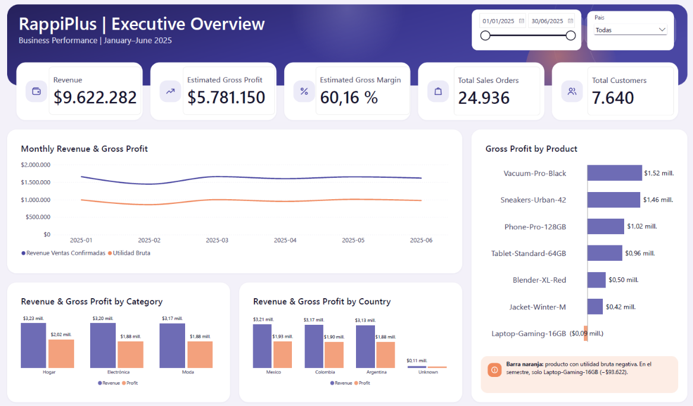
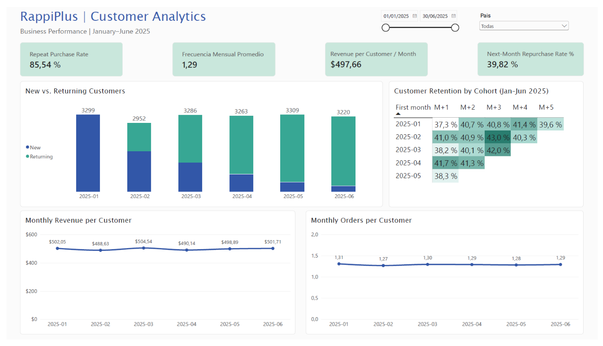

# RappiPlus | Desempeño del negocio, retención y experimentación

**Python · SQL (PostgreSQL) · Power BI · Pruebas estadísticas**

🌐 [English](README.md) · **Español**

Seis meses de datos de un e-commerce en Argentina, Colombia y México (enero–junio de 2025), desde la validación de los datos hasta las recomendaciones de negocio: rentabilidad, comportamiento de clientes, embudo de conversión, retención por cohortes y una prueba A/B.

---

## Contenido

1. [Resumen ejecutivo](#resumen-ejecutivo)
2. [Preguntas de negocio](#preguntas-de-negocio)
3. [Dashboard](#dashboard)
4. [Hallazgos principales](#hallazgos-principales)
5. [Calidad y validación de datos](#calidad-y-validación-de-datos)
6. [Recomendaciones](#recomendaciones)
7. [Metodología](#metodología)
8. [Limitaciones](#limitaciones)
9. [Estructura del repositorio](#estructura-del-repositorio)
10. [Cómo ejecutarlo](#cómo-ejecutarlo)
11. [Sobre este proyecto](#sobre-este-proyecto)

---

## Resumen ejecutivo

- **~60 % de margen bruto, ~30 % después de marketing.** El margen bruto estimado fue de **60.16 %**; después del gasto en marketing, el margen de contribución estimado bajó a **29.77 %**. El marketing absorbe cerca de la mitad de la utilidad bruta.
- **Un producto pierde dinero.** Laptop-Gaming-16GB generó una pérdida bruta estimada de **93,621.66** (margen de **-8.63 %**).
- **Los clientes vuelven, pero no todos los meses.** El **85.54 %** de los compradores compró más de una vez, pero solo entre el **37 % y el 42 %** de los compradores de cada mes volvió a comprar al mes siguiente.
- **Las ventas no mostraron crecimiento sostenido.** Las ventas de junio fueron **2.46 % menores** que las de enero.
- **Todavía no conviene lanzar el rediseño del checkout.** El aumento observado (+0.60 pp) **no fue estadísticamente significativo** (p = 0.4161), y la prueba solo tenía potencia para detectar efectos de unos **2 pp**.
- **La limpieza de datos cambió el panorama.** 10 pedidos con cantidades extremas representaban cerca del **81.4 % del monto registrado**; sin excluirlos, todas las cifras de ingresos estarían distorsionadas.

---

## Preguntas de negocio

| # | Pregunta | Respuesta en |
|---|---|---|
| 1 | ¿Podemos confiar en los datos? | [Calidad y validación de datos](#calidad-y-validación-de-datos) |
| 2 | ¿Estamos ganando dinero? | [Rentabilidad](#1-rentabilidad-antes-y-después-del-marketing) |
| 3 | ¿Dónde abandonan los usuarios? | [Embudo de conversión](#4-embudo-de-conversión) |
| 4 | ¿Los usuarios vuelven? | [Comportamiento de clientes](#3-comportamiento-de-clientes-y-retención) |
| 5 | ¿Funcionó el cambio de producto? | [Prueba A/B](#5-prueba-ab-rediseño-del-checkout) |

---

## Dashboard

### Resumen ejecutivo



### Análisis de clientes



📄 [PDF del dashboard](dashboard/RappiPlus%20Dashboard.pdf) · 📊 [Archivo de Power BI (.pbix)](dashboard/RappiPlus%20Dashboard.pbix)

*El dashboard está en inglés.*

---

## Hallazgos principales

### 1. Rentabilidad antes y después del marketing

| Métrica | Valor | Margen |
|---|---:|---:|
| Ingresos por ventas confirmadas (1 ene – 30 jun) | 9,622,281.56 | — |
| Utilidad bruta estimada (1 ene – 30 jun) | 5,781,149.93 | 60.16 % |
| Gasto en marketing (1 ene – 29 jun) | 2,871,843.53 | — |
| **Contribución estimada después de marketing** | **2,813,813.64** | **29.77 %** |

*El margen bruto usa solo las ventas con costo de producto disponible (base de ingresos: 9,610,018.94). El cálculo después de marketing usa un alcance comparable: el periodo en común (1 ene – 29 jun), países y canales conocidos, y ventas con costo disponible (ingresos: 9,450,739.67; utilidad bruta: 5,685,657.17, también 60.16 %). Es una estimación descriptiva, no la utilidad atribuida a campañas ni la utilidad neta. No incluye logística, comisiones ni otros costos operativos. Todos los montos están en una sola unidad monetaria para los tres países, tal como vienen en el dataset.*

### 2. Rentabilidad por producto

- Vacuum-Pro-Black y Sneakers-Urban-42 generaron la mayor utilidad bruta estimada.
- **Laptop-Gaming-16GB** fue el único producto con pérdida bruta: **-93,621.66** (margen de **-8.63 %**).
- Cuatro productos mostraron márgenes superiores al 90 %. Estas cifras dependen de los costos del catálogo y deben validarse antes de tomar decisiones de precios.

### 3. Comportamiento de clientes y retención

| Métrica | Valor |
|---|---:|
| Pedidos de venta | 24,936 |
| Clientes compradores | 7,640 |
| Tasa de recompra (ene–jun) | 85.54 % |
| Pedidos promedio por cliente | 3.26 |
| Pedidos por cliente por mes activo | 1.29 |
| Ingreso por cliente por mes activo | 497.66 |
| Tasa de recompra al mes siguiente (agregada, ene–may) | 39.82 % (rango mensual: 37.25 % – 41.99 %) |
| Retención por cohorte (D7–D28 después del registro) | 39.82 % – 43.98 % |

La mayoría de los clientes vuelve a comprar dentro del semestre, pero cerca del 60 % de los compradores de un mes no compra en el mes siguiente. La retención se mantuvo estable entre cohortes de registro, sin señales de mejora en el tiempo.

### 4. Embudo de conversión

Las vistas del embudo señalan **el checkout y el pago como etapas que vale la pena investigar**, pero el conteo de eventos por sí solo no confirma dónde abandonaron los usuarios su compra.

| Etapa | Usuarios que llegan a la etapa (en cualquier orden) | Usuarios que completan las etapas en secuencia estricta |
|---|---:|---:|
| Primera visita | 7,796 | 7,796 |
| Selección de producto | 7,582 | 6,728 |
| Agregar al carrito | 7,634 | 4,983 |
| Inicio de checkout | 7,208 | 2,663 |
| Información de pago | 6,250 | 919 |
| Compra | 6,240 | 258 (3.31 %) |

- En la vista de secuencia estricta, la mayor caída relativa ocurre entre la información de pago y la compra (**-71.93 %**).
- En la vista en cualquier orden, la mayor caída ocurre entre el inicio del checkout y la información de pago (7,208 → 6,250).
- **El 3.31 % es la tasa de finalización en secuencia estricta, no la tasa de conversión general de ventas.** Los conteos de eventos abarcan distintas sesiones y fechas; una tasa de conversión de visitante a comprador requeriría una población y una ventana de tiempo consistentes. Ver [Calidad y validación de datos](#calidad-y-validación-de-datos).
- **Los compradores varían según la fuente y la definición.** Los registros de ventas muestran **7,640** clientes compradores; los datos de eventos muestran **6,240** usuarios con un evento de *compra*, y solo **258** que completaron todas las etapas en orden estricto. El embudo describe rutas de navegación en el registro de eventos; las métricas de clientes de la sección anterior provienen de los registros de ventas.

### 5. Prueba A/B: rediseño del checkout

| Grupo | Usuarios | Conversiones | Tasa de conversión |
|---|---:|---:|---:|
| Control | 4,965 | 779 | 15.69 % |
| Tratamiento | 5,035 | 820 | 16.29 % |

- Aumento observado: **+0.60 pp** (+3.80 % relativo).
- Prueba z de dos colas: **p = 0.4161**; IC del 95 %: **[-0.84, +2.03] pp**. El intervalo incluye el cero.
- Sin desbalance en la asignación de muestras (SRM p = 0.4839).
- **Potencia:** con ~5,000 usuarios por grupo (α = 0.05, potencia del 80 %), el efecto mínimo detectable era de unos **2.0 pp**. Detectar un aumento de +0.60 pp requeriría cerca de **58,600 usuarios por grupo**.

**Decisión:** el resultado no es concluyente; no demuestra que el rediseño no tenga efecto. No lanzarlo con base en esta prueba; repetirla con un efecto mínimo detectable definido de antemano y un tamaño de muestra calculado para ese efecto.

### 6. Eficiencia del marketing

- La relación ingresos/gasto osciló entre **3.06 y 3.51** en las nueve combinaciones de país y canal; la búsqueda pagada (*paid search*) quedó primera en los tres países.
- El gasto diario y las ventas diarias mostraron una **correlación despreciable** (Pearson entre -0.069 y +0.098).
- Son indicadores descriptivos, no atribución ni ROAS.

---

## Calidad y validación de datos

**Problemas encontrados y tratados**

- Se eliminaron 100 filas duplicadas.
- 610 valores faltantes en ocho columnas; los costos faltantes **no** se reemplazaron por cero.
- 10 pedidos con cantidades extremas representaban cerca del **81.4 % del monto registrado**. Se excluyeron del análisis y se guardaron por separado para auditoría.
- 4 pedidos con cantidades negativas se trataron como posibles devoluciones.
- Se estandarizaron etiquetas inconsistentes de país y categoría; se recuperaron 101 canales de marketing y 50 de 80 categorías de producto faltantes a partir de datos de referencia.

**Inconsistencias señaladas para seguimiento**

- **Compradores nuevos vs. registros.** La proporción de compradores por primera vez *observados en los pedidos disponibles* cae mes a mes (ver *New vs. Returning Customers* en el dashboard), mientras que los registros se mantienen entre 1,444 y 1,687 usuarios por cohorte mensual. Una primera compra observada no es necesariamente la primera compra histórica del cliente. Estas fuentes y definiciones deben conciliarse antes de sacar conclusiones sobre adquisición.
- **Registro de eventos.** Más usuarios registraron *agregar al carrito* (7,634) que *selección de producto* (7,582), y hay menos usuarios con evento de *compra* (6,240) que compradores en los registros de ventas (7,640). Esto sugiere un registro de eventos incompleto o inconsistente.
- **Cobertura.** Los datos de marketing terminan el 29 de junio, mientras que los pedidos llegan hasta el 30 de junio. Las comparaciones de marketing usan solo el periodo en común.

---

## Recomendaciones

1. **Revisar Laptop-Gaming-16GB**: precio, descuentos y costos, y validar los márgenes inusualmente altos de otros productos.
2. **Trabajar la recompra al mes siguiente.** Probar acciones de retención dirigidas al ~60 % de los compradores mensuales que no vuelven al mes siguiente.
3. **Investigar la fricción en el checkout y el pago**, y auditar el registro de eventos antes de usar el embudo como KPI.
4. **Mejorar la medición del marketing** (atribución, costo de adquisición de clientes) antes de redistribuir el presupuesto; la contribución estimada es descriptiva, no una atribución por campaña.
5. **Repetir el experimento del checkout** con un efecto mínimo detectable y un tamaño de muestra definidos de antemano (≈58,600 usuarios por grupo para detectar +0.6 pp, o decidir si ~2 pp es el efecto mínimo que justifica actuar).

---

## Metodología

| Paso | Pregunta | Herramientas | Notebook |
|---|---|---|---|
| 1 | ¿Podemos confiar en los datos? | Python, Pandas | [01_data_quality](notebooks/01_data_quality.ipynb) |
| 2 | Preparar datasets limpios | Python, Pandas | [02_data_cleaning](notebooks/02_data_cleaning.ipynb) |
| 3 | ¿Estamos ganando dinero? | Python, Matplotlib | [03_business_analysis](notebooks/03_business_analysis.ipynb) |
| 4 | ¿Dónde abandonan los usuarios? ¿Vuelven? | PostgreSQL, SQLAlchemy | [04_sql_analysis](notebooks/04_sql_analysis.ipynb) · [Archivos SQL](sql/) |
| 5 | ¿Funcionó el cambio? | SciPy (prueba z, chi-cuadrado) | [05_ab_testing](notebooks/05_ab_testing.ipynb) |
| 6 | ¿Cómo lo comunicamos? | Power BI, DAX | [dashboard](dashboard/) |

Los archivos originales se conservan en `data/raw/` y los resultados limpios están en `data/processed/`. Los notebooks están en inglés.

---

## Limitaciones

- El análisis cubre seis meses (enero–junio de 2025). No es posible establecer tendencias de largo plazo.
- Las estimaciones de utilidad excluyen las ventas sin costo disponible y las posibles devoluciones. La contribución después de marketing no incluye otros costos operativos y no es utilidad neta.
- Las relaciones ingresos/gasto y las correlaciones no establecen causalidad ni atribución publicitaria.
- La retención por cohorte mide actividad en días específicos después del registro, no actividad continua ni recompras. Los compradores "nuevos" son los observados por primera vez en los datos de ventas disponibles, no necesariamente nuevos en términos históricos.
- El proyecto usa un dataset educativo, por lo que algunos patrones pueden reflejar cómo se generaron los datos y no el comportamiento real de clientes.

---

## Estructura del repositorio

```text
rappiplus-business-analysis/
├── dashboard/        # Archivo de Power BI, PDF y capturas
├── data/
│   ├── raw/          # Datasets originales
│   └── processed/    # Datasets limpios y outliers excluidos
├── notebooks/        # Notebooks de análisis 01–05
├── sql/              # Consultas de embudo y cohortes
├── .env.example      # Plantilla de conexión a la base de datos
├── requirements.txt
├── README.md         # Versión en inglés
└── README_ES.md      # Versión en español
```

---

## Cómo ejecutarlo

<details>
<summary>Instrucciones de instalación</summary>

### 1. Clonar el repositorio

```bash
git clone https://github.com/camilalealle/rappiplus-business-analysis.git
cd rappiplus-business-analysis
```

### 2. Crear y activar un entorno virtual

```bash
python -m venv .venv
```

**Windows (PowerShell):**

```powershell
.\.venv\Scripts\Activate.ps1
```

**macOS / Linux:**

```bash
source .venv/bin/activate
```

### 3. Instalar dependencias

```bash
python -m pip install -r requirements.txt
```

### 4. Ejecutar los notebooks

Abre el proyecto en VS Code o Jupyter y selecciona el intérprete/kernel de Python de `.venv`.

Ejecuta los notebooks en orden:

1. `01_data_quality.ipynb`
2. `02_data_cleaning.ipynb`
3. `03_business_analysis.ipynb`
4. `04_sql_analysis.ipynb`
5. `05_ab_testing.ipynb`

**Importante:** ejecuta los notebooks con `notebooks/` como directorio de trabajo para que las rutas relativas a los datos funcionen.

**PostgreSQL:** el notebook `04_sql_analysis.ipynb` requiere acceso autorizado a una base de datos PostgreSQL externa. Copia `.env.example` como `.env`, agrega credenciales de conexión válidas y verifica que las tablas necesarias sean accesibles. Las credenciales no están incluidas en el repositorio. Las consultas SQL guardadas y los resultados del notebook pueden revisarse sin conexión a la base de datos.

Sin acceso a PostgreSQL, puedes ejecutar los notebooks 01, 02, 03 y 05 de forma independiente.

</details>

---

## Sobre este proyecto

Desarrollado por **Camila Leal Ledesma** como proyecto final del programa de Análisis de Datos de TripleTen, y ampliado de forma independiente con validaciones adicionales, pruebas estadísticas y documentación.

[LinkedIn](https://www.linkedin.com/in/camila-leal-ledesma) · [GitHub](https://github.com/camilalealle)
